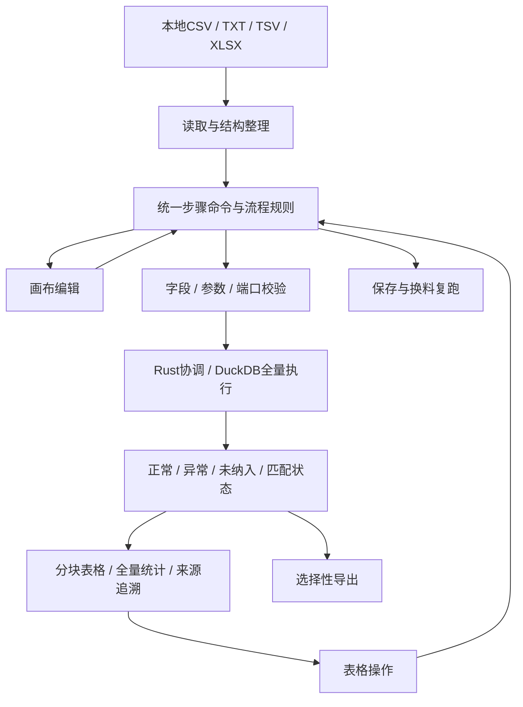

# 审计数工坊：基础数据处理完整方案

确认保存日期：2026-11-02。状态：用户确认保存的完整方案，未实施能力仍为目标，不构成代码、依赖安装、构建或Git授权。本轮未重跑产品测试。

本文件是当前完整方案正文；[开发路线](04_开发路线.md)负责实施依赖与进入条件，[需求确认单](01需求确认单.md)保留目标与黄金预期，[HANDOFF](03_HANDOFF.md)记录事实与恢复入口。既有专项文档中固定画布主入口、旧A—E排期、渐进界面改造或将底稿上数列为未来目标的条款不再适用，不得继续作为实施依据。仍有效的技术契约和历史验收证据不因计划替代而失效。

## 1. 产品目标与交付范围

面向审计人员处理TB、JE、财务明细账及各类台账，完成：读取整理 → 清洗筛选 → 行列处理 → 公式计算 → 查找匹配／多表合并 → 分类及透视汇总 → 复核导出 → 保存复跑。

表格和画布是同一流程的两个编辑入口：表格操作生成或修改可执行步骤，画布新增节点、修改参数、连线和分支后，表格查看对应输入与结果。保存处理规则与资料绑定，换期资料后可复跑。AI后续可选，基础功能不依赖AI；底稿自动上数不开发。不承诺完整复制Excel、Alteryx或Power BI。

## 2. 技术路线、复用与研究边界

|部分|实现决定|
|---|---|
|桌面与画布|保留Tauri、React及React Flow，不重复安装既有环境|
|计算|复用Rust＋DuckDB及已有金额、公式、排序去重和分类汇总；前端不另算正式金额|
|表格|AG Grid Community为待验证首选；通过当前React、TypeScript、Tauri及许可检查后锁定稳定精确版本，不预先认定接入成功|
|流程规则|沿用项目结构，补统一命令、版本化配置、兼容检查|
|字段|当前输入结构、用户保存规则、推导输出及本批实际字段分别管理|
|结果|以有效运行批次为依据，分页、统计、异常与导出共用身份|

组件负责显示、滚动、列宽、固定列和基础交互；全量筛选、金额、匹配和透视由产品规则及DuckDB执行。不得依赖付费Enterprise能力实现已承诺的免费路径；不得只排序、筛选或导出已加载的预览行。

REA现有研究在本机outputs/rea-research/；字段配置追踪支持按真实连接取得结构、输入字段与保存规则分开建模、配置更新与全量执行分开考虑。静态路径不是完整运行时间线，缓存、调度和失效不能照推断实现，不复制专有代码。本地研究目录不入Git，干净检出不以它存在为前提。

项目已有writing-plans、frontend-design、react-flow、DuckDB相关、rust-testing及verification-before-completion方法分别支持范围、交互、图编辑、查询和验证；是否可调用以实际环境为准，不重新安装或全局部署，不因Skill扩大授权。

参考依据（本次仅保存此前已核对链接，未重新联网验证）：[AG Grid许可](https://www.ag-grid.com/react-data-grid/community-vs-enterprise/)、[分块加载](https://www.ag-grid.com/react-data-grid/row-models/)、[兼容说明](https://www.ag-grid.com/react-data-grid/compatibility/)、[Power Query Diagram view](https://learn.microsoft.com/en-us/power-query/diagram-view)。

## 3. 统一工作台与双向编辑

表格、画布、分屏三种视图均可使用；切换不改变规则、运行结果或项目dirty状态。整体重构现有交互，不继续堆叠旧按钮。

|区域|行为|
|---|---|
|项目栏|新建、打开、保存、撤销／重做、运行、导出|
|紧凑操作栏|读取、列处理、行处理、公式、匹配、合并和汇总，配置按需展开|
|步骤导航|选择步骤与输入／输出，显示待配置、待计算、运行、成功、失败|
|表格|多选列、紧凑列头菜单、筛选、来源和异常定位，不逐列堆常驻复选框和“筛选”文字|
|画布|节点配置、连接、指定位置插入、分支及多输入流程|
|共用步骤编辑器|表格与画布打开同一配置，不强制右侧作为唯一入口|
|底部状态栏|全量行数、所选金额列合计、有效数、空值和异常提示，不大块占据表格|

统一命令区分：新增末尾、修改指定节点、插入指定连线、从指定输出新建分支、删除／重连。已有下游时不自动改接全部分支；修改保持节点ID；一次业务动作对应一次撤销事务。复杂动作可以生成多个底层节点，但作为整体恢复。

配置草稿与有效规则分开。打开或输入配置不即刻修改流程；校验后应用并明确计算，失败保留输入与诊断。规则改变使旧结果失效，旧结果只能以明确历史身份查看，不作当前统计或导出。输入视图发起操作须明确对象是上游输入，不假称当前节点输出。

任意单元格自由改值不纳入基础目标；删行、替换和公式通过可复跑规则表达。图中未完成的多输入处理不因新界面出现就算已实现。

## 4. 全部数据处理能力

### 4.1 读取与结构整理

路径：选择文件 → 核实原始表格和读取区域 → 查看整理效果 → 表格附近确认并计算。

- CSV／TXT／TSV设置编码、分隔符与表头记录；XLSX选择工作表、表头首末行、明细首末行及列范围。
- 展开多层表头，修正空名称和重名；合并区域只对明确允许的字段补值，普通空白不自动填。
- 首部、指定位置、尾部有限窗口查看，显示真实位置；跨行CSV按完整记录处理，物理行号与记录号分开。
- 每份资料分别整理顶部标题、空行、尾部合计和说明。范围规则明确结束行／记录；内容规则依据指定列的值、空白组合或条件排除。
- 不默认删最后几行，不将所有含“合计”的行删除；排除去向与理由可核实。
- 换料先检查结构差异，确认后替换，放弃可恢复原绑定。
- 尾部可能需扫描全文件，显示处理中；有限窗口不代表读取成本恒定。原始资料只读。

### 4.2 筛选、反选与多条件

- 全量值搜索、勾选、包含、排除；NULL和空字符串分别处理。
- 文本、金额、日期条件，多条件全部满足／任一满足；显示当前步骤条件，清除本列或当前步骤条件。
- 值来自后台全量查询；编辑某列时以该步骤输入加其他列条件为范围，排除本列自身条件。
- 跨页已选值保留；反选以包含／排除完整集合表示，不仅针对已加载选项；搜索只找选项，不偷偷改变规则。
- 清除只影响明确编辑的步骤，不删除历史同列筛选。正常与未纳入可分别查看导出。
- 同表AND／OR筛选与跨表VLOOKUP类查表补列分开，后者见4.6。

### 4.3 金额转换与求和

多选列一次配置，保留原值；成功后显示输出、定位新列并展示全量统计。明确精度、负数、金额文本格式；非法字符、空值、超精度保留诊断。

币种前缀、千分位、括号负数作为显式选项逐项实现与测试，不无条件去字符；不同币种须明确分组或换算后合计，不自动决定汇率。未明确规则前沿用原严格转换，CNY／USD等失败可查看原因。

筛选后全量求和；多列分别统计，不默认相加；显示参与范围、有效数、空值数。全NULL与真实0分开；转换失败未参与合计须显示数量与去向。当前定点精度DECIMAL(28,4)及严格错误政策不因界面变化放宽；更改精度或舍入须单独定口径。

**已确认的目标规则（基础按格转换与逐列合计已有实现，格式选项已有代码，完整流程待验收）**

| 输入情况 | 转换与计算规则 |
|---|---|
| 数字、可识别的文本数字、数字前后普通空格 | 转为定点金额。保留原值，按列参与计算。 |
| 空单元格、空串、仅普通空格 | 默认保留空值。按资料和列明确启用「空白按零」后才补零，记录来源及补零数量。真实零与补零可区分。 |
| 无法识别的文本、数字内部空格 | 标记该格待确认，保留原值、列名、行来源及原因。同一行其他有效金额照常参与各自列的计算。 |
| 特殊空白、千分位、括号负数、币种符号 | 逐类定义并验证后作为显式选项。未确定的格式进入待确认，不自动去符号或推断币种。 |
| 超过四位小数或科学计数法 | 维持严格精度规则，标记该格待确认，不静默舍入。 |

主结果保留整行，复核视图列出异常格。合计同时显示已识别金额和未计入格数，区分没有有效金额与有效金额合计为零。差额等依赖多格的公式在输入均有效时计算，缺少有效输入时只标记该行的公式结果待确认。

**版本兼容**：原版本金额步骤仍按整行分流。新建金额步骤保留全部记录，按列显示有效数、空白、转换失败及补零。既有测试和实样记录按相应版本解读。旧步骤的主动转换入口及主结果与异常重叠的完整导出流程待验收；格式选项实现规则见末节。

### 4.4 行列处理与ID

保留、删除、移动、更名列；多字段稳定排序；按条件或明确来源记录保留／排除行；重复识别、条数、组内序号；按明确顺序保留首／末，其余进入未纳入。无可靠顺序不猜首末。

原始行号、来源文件、工作表可添加为业务字段并参与公式／导出；结果重新编号另设。来源身份用于反查，批次内结果行身份用于分页与选择，显示顺序用于查看和导出。排序不改变原始行号，多文件相同行号不混同；汇总回查组成行，不伪造单行ID。

### 4.5 Excel风格公式新增字段

提供函数分类、字段插入、参数说明、试算、错误定位和明确支持清单，不承诺全部Excel兼容，不要求普通用户先写正则。

|类别|目标能力|
|---|---|
|数学|加减乘除、绝对值、明确舍入等|
|文本|拼接、LEFT／RIGHT／MID、LEN、定位、替换、按分隔符提取|
|逻辑|IF、AND／OR、空值判断|
|日期|明确格式解析、格式化、年月日提取、日期差|
|类型|文本、数值、日期显式转换|

受控解析和类型检查后由DuckDB执行，不以任意SQL作为普通公式入口。新列可放任意指定位置，保留原字段；错误不默认当0。

公司＋日期＋行号只是任意字段组合的例子，不限定字段个数或首列；组合后提供唯一性检查，不自动认定唯一。二级科目提取按实际长度／分隔规则使用文本函数，不固化某家公司层级。正则保留高级可选。日期歧义、编码前导零、除零、超精度均须固定预期。

### 4.6 查表补列与多表匹配

选择左右表、单／多键、带回字段和连接方式；支持内、左、右、全连接，匹配、仅左、仅右分开复核。明确类型、前导零、NULL和空字符串政策。

重复键不静默取首条；选择先汇总、允许一对多／多对多展开或拒绝非唯一匹配，并提示行数与金额影响。保留两侧金额、差额及来源。

固定资产两期对比是匹配＋差额的组合；TB／JE通常先对齐主体、期间、科目与借贷方向再汇总匹配。它们是通用能力验收例子，不建专用处理引擎。

### 4.7 多表纵向合并

每表独立整理读取和尾部，统一字段、类型后追加。支持同名对齐、异名映射、缺列处理、类型冲突检查、输入和结果顺序、每行来源。逐表及合并后核对行数与适用金额。不因同名就混用文本金额和数值，不无提示丢列。

### 4.8 分类及透视汇总

配置行维度、列维度、数值和筛选；多键分类、求和、记录数、非空计数、去重计数及明确的其他统计；月份等展开列；行列合计、总计、组成明细及来源回查。空组、空值与真实0分开。

动态列改变后重验下游；列数超限提示缩小维度，不无限展开。提供数据处理和透视配置，不扩大到完整Power BI、DAX或仪表板。

### 4.9 导出、保存与复跑

正常、异常、未纳入、匹配类别可分别导出；全量结果、指定列、按条件或明确记录选择的部分行可导出。导出前显示范围、行列数与排序，不将当前200行当全部；独立选择导出范围不隐式改写主流程。

CSV为确定交付格式；XLSX等更多格式须评估容量与类型保真后单独纳入，不默认完整Excel输出。保存重开、撤销重做、换料复跑、保存失败恢复均需验收；不覆盖原始资料。

## 5. 全量、性能与正确性

前端按块显示，后台处理全量；初始200行／块、单次最多500行，缓存初始最多10块；切规则或批次清空。分页有批次内唯一结果行身份与稳定顺序，非显式排序结果不承诺跨次运行位置相同。

值搜索、统计、翻页为只读查询，不创建处理批次；字段经校验、查询值参数化。正式金额精确文本传输，前端浮点不用于正式合计。请求共用项目会话、规则版本、步骤、方向、类别、批次及请求号，迟到响应拒绝回填。

现有引擎可能重算上游，不承诺增量缓存；先保证正确性，再按实测引入上游结果复用。缓存匹配输入、规则和执行版本，换料或上游修改失效。同一时刻限制执行，允许查看已有结果，不将UI停止动画称为真实取消。

长文本、高基数、宽表、多输入分档测耗时、内存和磁盘；历史千万行CSV不外推任意复杂XLSX和多表流程。

## 6. 异常、字段与版本治理

- 分流型异常将整行分开；标记型异常与主表可以重叠。旧版金额失败属于整行分流。新版按第4.3节按格标记，异常格不参与该列合计，行数与异常格数分别核对。
- 未纳入：明确筛选或排除；未匹配：连接一侧缺对应记录。类别不混称，不简单相加核行数。
- 缺字段、类型变化、重名指出具体位置，保留用户规则，不静默重置。
- 旧项目／节点按旧语义读，新规则带配置版本；未知版本拒绝。迁移不覆盖原件，若必须改整体格式先说明范围。
- 处理前后核输入身份，处理中变化则不作为有效结果。

## 7. 代码落点与复用资产

|位置|职责|
|---|---|
|workbench.tsx|收敛为协调入口，减少界面、动作及计算状态混杂|
|project.ts及统一命令／状态模块|项目类型、草稿、新增修改、插入分支、撤销与有效性|
|preview.ts及结果数据源|输入输出归属、请求身份及分块加载|
|工作台与表格组件|三视图、菜单、共用配置、状态栏|
|source_structure.rs及原始窗口模块|表头、范围、尾部、结构校验|
|field_contract.rs|按实际端口推导单／多输入结构；现首条输入逻辑不能冒充通用多输入合同|
|formula.rs|受控公式和逐函数扩展|
|table_ops.rs及筛选模块|行列、排序去重、版本化筛选|
|workflow.rs|节点、端口、依赖和版本校验|
|engine.rs|全量执行、物化、来源和异常|
|result_queries.rs|分页、值列表、统计和成员回查|
|匹配／追加／透视专项模块|扩展现有基础，避免继续堆积单文件|

A、B首版保留复用；通用Join、多输入字段合同、透视动态字段仍须补齐，不能凭节点名称认定完成。上述为总体落点，非全部源码写入授权；实施前仍列精确文件、接口、规则、产物和停止条件。

## 8. 整体实施依赖与交付门槛

|顺序|成果|门槛|
|---|---|---|
|1|组件验证、统一命令、字段与结果身份|桌面兼容、双向动作、失效和撤销正确|
|2|新工作台、读取整理、全量表格|头尾范围正确，换料可恢复，分页无重漏|
|3|筛选反选、金额转换与合计|预览外记录可筛，全量金额与异常去向准确|
|4|行列、ID、公式、部分导出|来源稳定，公式固定预期和导出范围可核|
|5|通用匹配与多表追加|重复键、单侧、类型与行数影响明确|
|6|分类与透视|逐格、合计、动态字段及成员回查正确|
|7|完整组合与换料复跑|两入口等价流程结果一致，保存重开可复现|

这是同一完整产品的内部依赖，不是几个不同目标；第一步或首批完成不得称为全产品完成。原30文件清单和后续仅覆盖工作台闭环的清单不得直接作为全部功能开工清单。

组件关口先用虚构样例核对当前React、TypeScript、Tauri、中文、缩放、键盘、多选列、菜单定位、固定列、滚动、分块及免费能力。失败停止并报告，不悄悄换库、买许可、降级React或新增框架。依赖版本先核实再锁定，只有代码范围获准后才安装。

## 9. 完整验收体系

|组别|必须覆盖|
|---|---|
|读取|多层表头、合并、普通空白、头尾说明、跨行CSV|
|筛选|NULL、空串、跨页值、反选、AND／OR、清除、空结果|
|金额|正负、零、空值、格式错误、超精度、未参与合计异常|
|行列／公式|来源ID、稳定顺序、首末去重、列位置、中文、歧义日期、除零|
|匹配|单多键、前导零、重复、一对多、多对多、左右单侧|
|合并|异名、缺列、类型冲突、尾部、来源与行数守恒|
|透视|重复组合、空组、动态列、逐格和总计、组成明细|
|双向|同节点更新、历史插入、分支、改线、撤销、过期响应|
|复用导出|部分行列、全量及异常导出、保存失败、重开、换料|
|规模|长文本、高基数、宽表、多输入、耗时及磁盘|

固定对照例子：201行前200行各1、末行1000，全量1200且末行独有值可筛；两层表头及头尾说明整理后恰好4条明细；虚构公司A／B／NULL条件结果；资产X／Y／Z单侧与重复键；月份透视逐格及总计。预期先固定，不能从程序结果反填。

使用独立Python Decimal等核金额，按需人工Excel对照；现有回归与新增有价值测试、前端构建、Rust及CLI黄金／精度／负例／追加均按变更执行。界面必须真实桌面操作，含1280×720和1920×1080尺寸检查。

最终从空白完成两条等价路径：表格起建并转画布修改复跑；画布起建并转表格修改复跑。导出逐行／逐组、金额、来源、异常去向与保存重开一致。代码完成、自动测试、桌面验证、用户人工验收分别记录，不能互相替代。

## 10. AI、文档、产物与停止条件

AI后续可选：读取结构／映射／步骤建议、自然语言生成受控公式、解释已取得异常；用户确认和程序校验后应用。不默认发送客户全量数据，不由AI决定审计口径或替代确定计算。AI不开发不妨碍基础工具完整使用。

需求单管目标预期，本方案按章节记录功能规则、实现边界和完整设计，路线管依赖和门槛，决策日志管理由，HANDOFF管进度证据。旧Excel是生成时快照，本轮不更新、不作当前方案权威。

运行与验收产物放topic内outputs/；工作台重构建议outputs/workbench-rebuild-acceptance/下component-check、fixtures、projects、runs、exports、screenshots、reports。后续专项产物目录在精确清单确认；不生成顶层游离产物，不覆盖原件。构建使用已有目录，替换二进制前核占用，不擅自关闭用户窗口。

发现未列依赖／付费需求、保存版本或金额政策变化、数据错位／核对差异、旧结果串入时停止相关部分；同问题三轮失败停下说明。桌面权限不足标未验证，不以构建代替。不得清理历史运行目录或原始资料来掩盖失败。

本次仅保存方案及清理指定文档中过期计划，不改代码、测试、依赖、Excel、README、真实资料、其他项目、两个.gitkeep或FDE台账；不执行Git。后续每次代码写入与Git仍按工作区AGENTS.md分别确认。

## 本轮已落实规则与待验边界

- 新版关联按左右端口执行，内／左／右／全连接、异名组合键、单列或多列带回。NULL不匹配，空文本由选项决定。默认拒绝实际匹配中的重复键展开，预检显示匹配及两侧独有行数和金额重复计入影响；明确允许后仍限制最多100万输出行。1000×1000的窄表边界已对拍，不据此推断复杂资料的性能。
- 新版追加支持有顺序的多输入、目标类型、逐表映射、明确补空及排除。每个目标字段至少有一个真实输入确认类型。结果保留来源及追加输入编号，另生成确定的结果顺序。
- 透视按原始成员独立计算行合计、列合计和总计。动态统计列合计最多200列，另计行维度、汇总层级和总计列。缺组合为空，真实零保留。输出列名称包含稳定标识；本次运行保存列维度映射，按格回查使用保存的规则。透视下游实际字段在本次计算产生后检查，换料缺列会阻止后续执行及导出。
- 普通数值合计不重复相加透视中的总计行，透视使用自身总计。透视去重总计从对应原始成员重算。
- 范围导出独立于主流程，预检绑定当前运行、类别、条件、选列及明确记录。记录选择基于本批结果的稳定顺序，跨200行分块保留。发布CSV前再次锁定当前批次，失效时不替换既有文件。
- 来源记录保留／排除保存实际来源组合及原文件指纹。来源不能唯一对应一行时提示改用明确条件，原文件改变后要求重新选择。单次最多1000条来源记录，较大范围使用条件。独立导出可选择最多100000条记录。
- 金额格式选项逐列保存。可明确启用首尾特殊空白、严格逗号千分位、括号负数及一个币种前缀。支持¥、￥、CNY、RMB、USD、$、EUR、€、HKD、HK$，不换算汇率。非法分组、其他币种和内部空格继续待确认。旧版步骤不改变。
- 日期转换必须指定yyyy-mm-dd、yyyy/mm/dd、yyyymmdd、dd/mm/yyyy或mm/dd/yyyy之一，按格式回转检查，拒绝自动猜日期。日期筛选比较值为严格yyyy-mm-dd。公式补入ABS、ROUND、AND、OR、VALUE、TOTEXT、DATE、DATEVALUE、TEXT、YEAR、MONTH、DAY、DATEDIFF。TEXT当前用于日期格式化，DATEDIFF按天计算结束减开始，ROUND显式选择0至4位，VALUE不吞掉超四位精度。
- 原始窗口以有限内存展示首部、指定位置和尾部。文本按完整记录，保留物理起始行，跨行摘要不截断；尾部需扫描全文件。窗口查看不修改读取范围。
- 本节为实现规则记录。新增格式、日期、编号、分块及完整桌面组合仍须以最新自动和桌面对拍记录确认，不能以代码存在代替验收。
